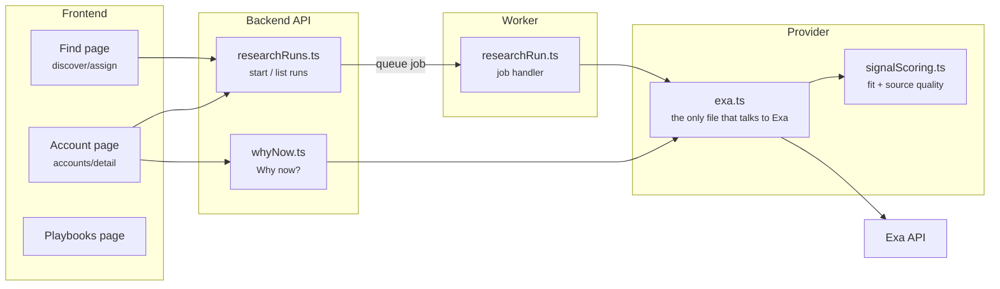
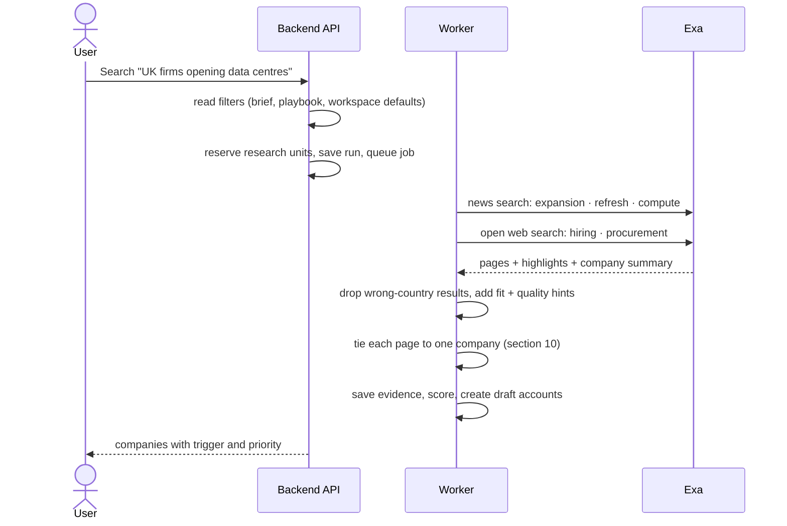
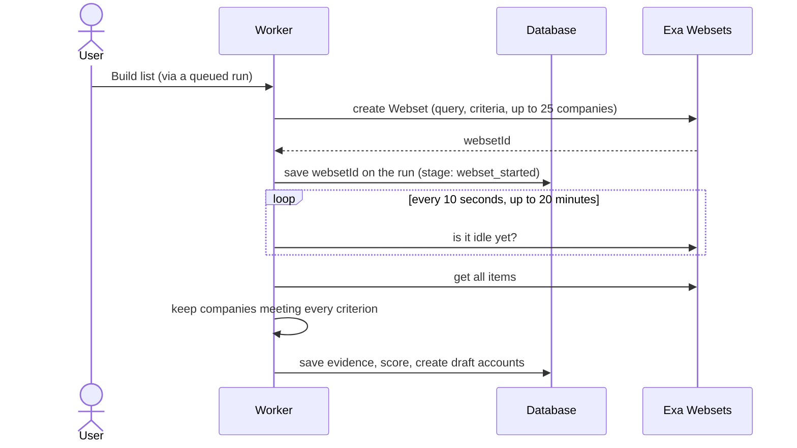
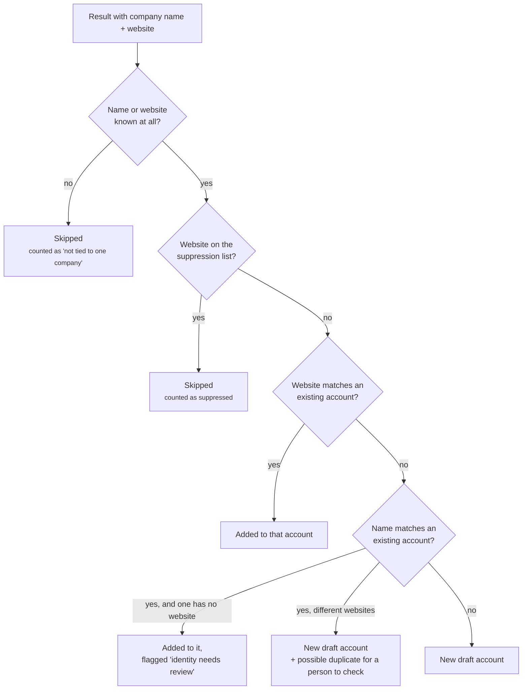

# How research works (Exa)

- [1. What Exa does for Insyder](#1-what-exa-does-for-insyder)
- [2. Where the code lives](#2-where-the-code-lives)
- [3. The research features at a glance](#3-the-research-features-at-a-glance)
- [4. Quick search (Find leads)](#4-quick-search-find-leads)
- [5. Researching one account](#5-researching-one-account)
- [6. Find similar companies](#6-find-similar-companies)
- [7. Build a list (Websets)](#7-build-a-list-websets)
- [8. Why now? (Exa Answer)](#8-why-now-exa-answer)
- [9. Required phrase](#9-required-phrase)
- [10. From article to lead: company matching](#10-from-article-to-lead-company-matching)
- [11. How the priority score is worked out](#11-how-the-priority-score-is-worked-out)
- [12. Research units (budget)](#12-research-units-budget)
- [13. Errors, retries and safety](#13-errors-retries-and-safety)
- [14. Testing and changing it](#14-testing-and-changing-it)

---

## 1. What Exa does for Insyder

[Exa](https://exa.ai) is a web search API built for software. Insyder uses it to find **public evidence that a company may soon buy infrastructure**: a new site or data centre, infrastructure job ads, a hardware refresh, added compute capacity or a tender.

Exa can do more than plain search. Insyder uses:

| Exa feature | What it gives us | Used by |
|---|---|---|
| **Search** (`searchAndContents`) | Pages matching a query, with the most relevant snippets (*highlights*) | Quick search, account research |
| **Structured summary** | Exa's AI reads each page and fills in a JSON form we define (company name, website, signal type) | Quick search, site crawl, find similar |
| **Category filter** | Limits a search to news articles | Quick search, account research |
| **Include text** | Keeps only pages containing an exact phrase | Required phrase |
| **Subpages** (`getContents`) | Crawls a website's inner pages (careers, news, press) | Account research |
| **Find similar** (`findSimilarAndContents`) | Websites that resemble a given website | Find similar companies |
| **Answer** | A short written answer to a question, with the sources it used | Why now? |
| **Websets** | A list of companies, each checked against criteria with cited sources | Build a list |

The API key (`EXA_API_KEY` in `backend/.env`) stays on the server. The browser never talks to Exa directly.

---

## 2. Where the code lives



| File | What it does |
|---|---|
| `backend/src/providers/research/exa.ts` | Builds every Exa request, turns Exa results into Insyder's own format, maps Exa errors to safe error codes |
| `backend/src/providers/research/types.ts` | The provider interface. Another search provider could replace Exa by implementing it |
| `backend/src/services/signalScoring.ts` | Fit and source-quality hints for each result |
| `backend/src/services/scoring.ts` | Combines fit, recency and quality into the 0–100 priority score |
| `backend/src/services/evidence.ts` | Saves sources and evidence, skips duplicates, scores each new item |
| `backend/src/jobs/handlers/researchRun.ts` | The background job: calls the provider, charges usage once, ties results to companies |
| `backend/src/routes/v1/researchRuns.ts` | API to start, list, export and delete research runs |
| `backend/src/routes/v1/whyNow.ts` | API for the Why now? summary |

---

## 3. The research features at a glance

Every feature except Why now? is a **research run**: a row in `research_runs` processed by the worker. The run's `mode` decides what happens.

| Feature | Where in the app | Run mode | Exa calls | Typical time | Units |
|---|---|---|---|---|---|
| Quick search | Discover → Find & assign → *Quick search* | `discovery` | 1–2 searches | seconds | 1 per result, up to 10 |
| Account research | Account page → *Run research / Re-research* | `account` | 1–2 searches + site crawl | seconds | 1 per result + 1 for the crawl |
| Find similar | Account page → *Find similar companies* | `similar` | find-similar | seconds | 1 per result, up to 5 |
| Build a list | Discover → Find & assign → *Build a list* | `webset` | Webset create + wait | minutes | 1 per company, up to 25 |
| Refresh list | Same page → *Refresh list* | `webset` | Webset search (append) | minutes | 1 per new company |
| Why now? | Account page → *Why now?* card | not a run | answer | seconds | 1 |

---

## 4. Quick search (Find leads)



**The search is split in two.** Expansion, refresh and compute signals are mostly reported in news, so they're searched with Exa's `news` category, which removes random pages. Hiring and procurement signals live on job boards and tender portals, so they're searched across the open web. The result budget is shared between the two in proportion to the signals asked for (`planSearches` in `exa.ts`). With the default 3 results and all five signals: 2 from news, 1 from the open web.

**What each search sends to Exa:**
- the user's query, plus the target industries and fixed phrases for each signal (for example *"hiring infrastructure engineers"*)
- `startPublishedDate`, so only pages inside the event window come back (default 90 days)
- `excludeDomains`: the offer's exclusions and the workspace's suppression list
- the required phrase as `includeText`, if one is set (section 9)
- a **structured summary** request asking which single company the page is about, its website, the signal type and a one-sentence summary

---

## 5. Researching one account

When someone clicks **Run research** on an account, two things happen at the same time:

1. **A web search** about that company, split into news and open web as above.
2. **A crawl of the company's own website.** Exa opens the homepage and up to 5 inner pages whose links match *careers, jobs, news, press* or *announcements*. Each page gets a structured summary, and only pages showing a real buying signal are kept (an "About us" page is dropped). These pages score high on source quality because they come from the company itself.

The crawl costs 1 unit. With the default budget of 3, that leaves 2 for the web search. A website that blocks crawling never fails the run: research completes with the search results alone.

---

## 6. Find similar companies

On an account with a website, **Find similar companies** asks Exa for websites that resemble it (`findSimilarAndContents`, with `excludeSourceDomain` so the company itself isn't returned).

Exa returns many kinds of pages, so results are filtered strictly:

- **Only company websites count.** News sites, job boards, blogs and business directories (LeadIQ, ZoomInfo, Crunchbase and similar) are dropped.
- **The page must be the company's own site.** Exa is asked which company the page is about *and* that company's own domain. If the two don't match (for example a LeadIQ profile page about Datum), the result is dropped. Without this check, a directory page would create a fake account like "Datum · leadiq.com".
- **Pages about the starting company are dropped.** They aren't lookalikes.

Results are saved as draft accounts with source **lookalike**. They have **no buying signal yet**: their event date is left unknown on purpose, so they score lower (around 50–60) and sit below real leads. Research them next to find a signal.

---

## 7. Build a list (Websets)

A Webset is Exa's way of building a **list of companies** and checking each one against written criteria. It's slower than a quick search but returns more companies, each with cited reasons.



**Criteria** are written from the run's filters (`websetCriteria` in `exa.ts`):
- *Company has publicly shown at least one of these in the last N days:* followed by the selected signals in plain words
- *Company operates in GB or IE* (when countries are set)
- *Company's public sources mention "…"* (when a required phrase is set)

Exa answers each criterion per company with **yes / no / unclear** and the references it used.

**What becomes evidence:** only companies where no criterion is "no". The evidence link is the cited reference behind a met criterion, preferring a third-party article over the company's homepage. The excerpt is the reference snippet plus Exa's reasoning. Accounts are created with source **list**.

**Refresh list** adds a new search to the same Webset with `behavior: append`. Only companies added since that search started are imported, so the refresh shows new matches only.

**Retries never build a second list.** The worker saves the `websetId` on the run *before* waiting. If the job is retried (for example because the list was still building after 20 minutes), it resumes waiting on the same Webset.

> Websets must be included in your Exa plan, and they cost much more than a search. If a list build fails partway, the app refunds the units it reserved, but Exa may already have charged for companies it found.

---

## 8. Why now? (Exa Answer)

The **Why now?** card on an account page asks Exa a fixed question:

> *Is {company} ({domain}) currently expanding to a new site, hiring IT infrastructure staff, refreshing servers or IT hardware, adding compute or storage capacity, or running an IT infrastructure tender? Answer in at most two sentences, saying what is happening and when.*

Exa searches, reads the pages and replies with a short answer plus its sources. The answer and up to 8 citations are saved on the account (`why_now_text`, `why_now_citations_json`, `why_now_at`), so reopening the page costs nothing. **Refresh summary** asks again.

It runs straight from the API, not as a background job, and costs 1 unit (refunded if Exa fails). The answer is AI-written, so the card labels it as such and it **never counts as reviewed evidence**. If Exa cites no sources, the card warns the user not to rely on it.

---

## 9. Required phrase

A playbook can set a **required phrase** of up to 5 words, for example *data centre* (Discover → Playbooks → Search defaults). Every search then sends it as Exa's `includeText`, so only pages containing that exact phrase come back. Lists add it as a criterion instead.

The match is exact: *data centre* doesn't match *data center*. Exa currently allows one phrase per search.

---

## 10. From article to lead: company matching

Quick search, find similar and lists all end in the same step (`accountsFromSignals` in `researchRun.ts`), which turns results into accounts:



Two companies can share a name with different websites (a UK and a US firm, or a parent and a subsidiary), so the app never merges them by itself. It creates a **possible duplicate** that a person resolves under Accounts: *Merge into A*, *Merge into B* or *They're different companies*.

Each saved item is also checked for duplicates: the same URL, the same text, or the same headline on the same day (syndicated copies) is skipped rather than saved twice.

---

## 11. How the priority score is worked out

Each new evidence item gets a score from 0 to 100. A company's priority is its **highest** item score, and a new run can raise it but never lower it.

```
priority = round(fit × 0.45 + recency × 0.35 + source quality × 0.20)
```

**Fit (45%)** starts at 30 and adds points for four checks (`fitHint` in `signalScoring.ts`):

| Check | Points |
|---|---|
| Signal type is one the search selected, or a list company met every criterion | +20 (+15 if no signals were selected, +5 for a known signal that wasn't selected) |
| Country matches the filter | +15 (+5 if unknown, +10 if there's no country filter) |
| Text mentions a target industry | +15 (+8 if there's no industry filter) |
| Company and its website identified | +15 (+7 for name only, or for account research where the company is already known) |

**Recency (35%)** comes from the publish date: within 30 days = 100, within 90 days = 70, older = 30, no date = 20.

**Source quality (20%)** comes from the publisher (`sourceQualityHint` in `signalScoring.ts`):

| Publisher | Score |
|---|---|
| The company's own website, official or government records (tenders, filings) | 90 |
| Major news (Reuters, FT, BBC…) | 85 |
| Trade press (DatacenterDynamics, The Register…) | 75 |
| Press-release wires | 70 |
| Job boards | 65 |
| Unknown sites | 55 |
| Blogs, social media, business directories | 35 |

**Typical results:**

| Lead | Priority |
|---|---|
| Fresh expansion news on the company's own site, matching every filter | about 96 |
| Fresh article in a major paper, company identified | about 80–90 |
| List company meeting every criterion (no event date) | about 70–80 |
| Lookalike from find similar (no signal yet) | about 50–60 |
| Old blog post, company unclear | about 30–40 |

The score ranks leads for attention. It is **not** a purchase probability, and missing evidence never raises it.

---

## 12. Research units (budget)

Each company (tenant) has a monthly quota of research units (default 100), shown under **Settings → Usage**.

1. **Reserve.** Starting a run reserves its full budget first. If that would go over the quota, the run is refused.
2. **Charge.** After Exa answers, the actual usage is recorded once in `provider_usage`: 1 unit per result returned (minimum 1), plus 1 for a site crawl.
3. **Refund.** Unused units go back. A run that fails before Exa charges anything is refunded in full.

Admins can pause all research from **Settings → Usage**.

---

## 13. Errors, retries and safety

**Exa errors are translated to safe codes** before they reach the database or the browser (`normalizeExaError` in `exa.ts`). No API key or raw Exa response is ever stored or shown.

| Code | Cause | Retried? |
|---|---|---|
| `provider_auth` | Exa rejected the API key | no |
| `provider_rate_limited` | Too many requests | yes |
| `provider_timeout` | No answer within 30 seconds, or a list still building after 20 minutes | yes |
| `provider_unavailable` | Exa server error | yes |
| `provider_bad_request` | Exa rejected the request (for example Websets not on the plan) | no |

**Retries never charge twice.** Research jobs retry up to 3 times with backoff. The usage row is written straight after Exa answers, and a retry that finds it reuses the stored results instead of calling Exa again.

**Web content is treated as untrusted.** Only short excerpts (up to 800 characters) are stored, every item keeps its source link, and evidence must be reviewed by a person before it counts for acceptance or outreach.

**Suppressed companies are never searched or saved.** Their domains are sent to Exa as exclusions and filtered again when results come back.

---

## 14. Testing and changing it

**Automated tests** use a fake Exa client, so they cost nothing and need no API key:

```bash
cd backend
npx vitest run src/providers/research src/services/signalScoring.test.ts
```

| Test file | Covers |
|---|---|
| `exa.discover.test.ts` | news / open-web split, site crawl, find similar filtering, required phrase, Why now? citations, Websets criteria, refresh and retries |
| `exa.test.ts` | reading Exa's structured company summary |
| `signalScoring.test.ts` | fit, source quality and the spread of final scores |

**To try it by hand,** set `EXA_API_KEY`, run `npm run dev` in `backend/` and `frontend/`, then use the features in section 3. Watch the backend terminal for worker errors.

**Common changes:**

| To change… | Edit |
|---|---|
| Search phrases for each signal | `SIGNAL_TERMS` in `exa.ts` |
| Which signals use the news category | `NEWS_KINDS` in `exa.ts` |
| Pages crawled on a company's website | `SITE_SUBPAGES`, `SITE_SUBPAGE_TARGETS` in `exa.ts` |
| Wording of list criteria | `SIGNAL_CRITERIA`, `websetCriteria` in `exa.ts` |
| Publisher lists and quality scores | `signalScoring.ts` |
| Score weights | `scoring.ts` |
| The Why now? question | `whyNowQuestion` in `whyNow.ts` |
