# How Insyder works

- [1. The idea in one picture](#1-the-idea-in-one-picture)
- [2. Who's who: companies, workspaces and members](#2-whos-who-companies-workspaces-and-members)
- [3. Roles: what each person does](#3-roles-what-each-person-does)
- [4. The life of a lead](#4-the-life-of-a-lead)
- [5. Each role's day, step by step](#5-each-roles-day-step-by-step)
- [6. How the parts connect](#6-how-the-parts-connect)
- [7. What happens when you click something](#7-what-happens-when-you-click-something)
- [8. Folder map: what lives where](#8-folder-map-what-lives-where)
- [9. Ground rules the app enforces](#9-ground-rules-the-app-enforces)

---

## 1. The idea in one picture

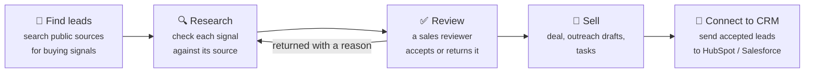

A **buying signal** is public evidence that a company may soon buy infrastructure, for example a new data centre announcement, infrastructure job ads, a hardware refresh or a public tender. Every signal is saved **with its source**, so anyone can check it.

---

## 2. Who's who: companies, workspaces and members

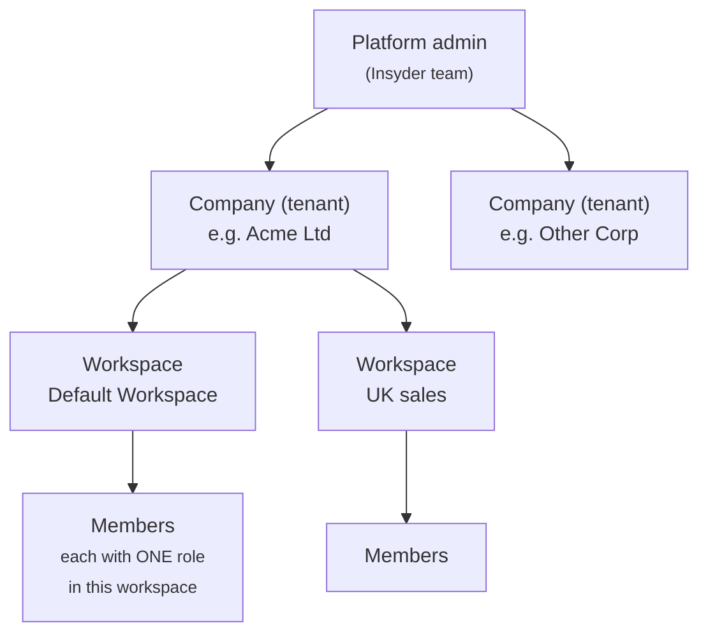

| Level | What it is |
|---|---|
| **Platform admin** | The Insyder team. Approves "Create account" requests, creates companies and sees platform-wide usage. Works in `/platform`. |
| **Company (tenant)** | One customer organisation. Its data is fully separated from every other company. It has one research budget per month and one CRM connection. |
| **Workspace** | A team or region inside a company (e.g. "UK sales"). Accounts, tasks, playbooks and settings belong to a workspace. |
| **Member** | A person in a workspace with **one role**. The same person can have different roles in different workspaces. |

Access comes **only** from an explicit membership. Belonging to a company does not by itself give access to its workspaces.

---

## 3. Roles: what each person does

Each role gets **its own portal**, with its own address (`/admin`, `/researcher`, `/reviewer`, `/sdr`, `/analyst`, `/partner`), its own menu and its own Overview dashboard.

| Role | Their job | Main pages |
|---|---|---|
| **Tenant admin** | Runs the workspace: members, settings, playbooks, suppression list, usage. **Only person who sends leads to the CRM.** Can do everything else too. | Overview, Discover, Accounts, Outreach, Reports, Members, Workspaces, Settings |
| **Researcher** | Finds leads, runs research, reviews evidence, writes the qualification brief, sends it to a named reviewer. | Overview, My leads (Qualify a lead, Work my tasks, Tasks), Find leads, Accounts, Drafts |
| **Sales reviewer** | Reads briefs and **accepts** (names an owner and next action), **sends back** (with a reason) or **rejects**. Manages deals and partner handoffs. | Overview, Review (Review a brief, Sales acceptance), Accounts, Outreach |
| **SDR** | Works accepted accounts: calls, emails and follow-ups, records outcomes, updates the deal, approves drafts. | Overview, My work, Accounts, Drafts |
| **Analyst** | Reads reports only. Changes nothing. | Overview, Reports |
| **Partner** | An outside company. Sees **only** the handoffs shared with them, and only the fields chosen for them. | Overview, Shared with me |

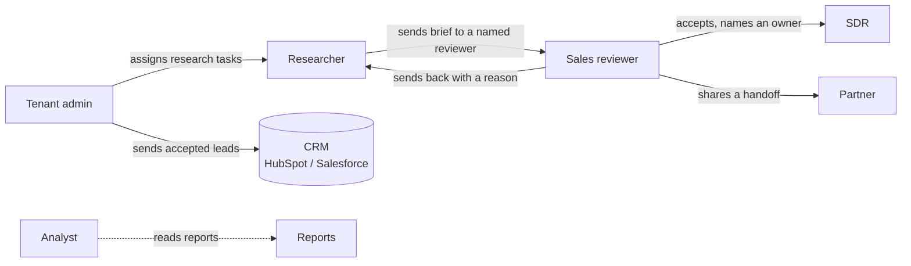

---

## 4. The life of a lead

A lead (an **account**) has two separate statuses: one for research and one for sales acceptance.

### Research status

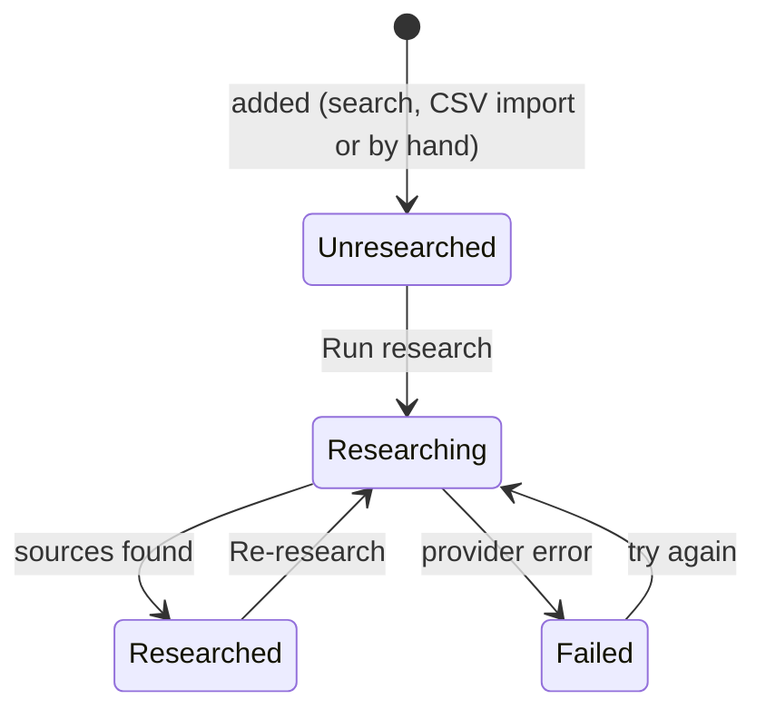

### Acceptance status

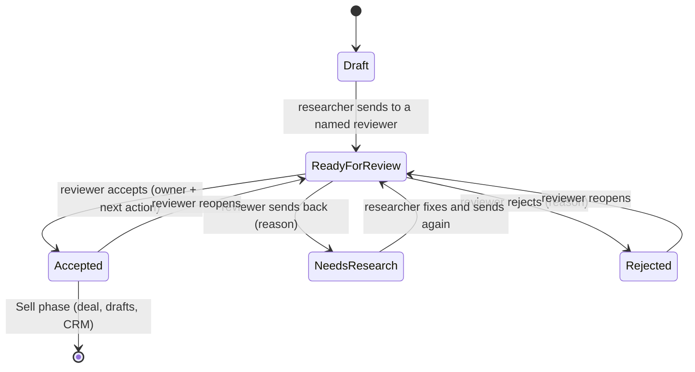

### The steps on an account page

The account page walks through the lead as steps, grouped in three phases. A step opens only when the steps it depends on are done. **Each person sees their own steps**; other roles' steps are read-only for them and don't count in their progress.

| Phase | Step | Done when | Owner |
|---|---|---|---|
| Research | Research the company | research finished | Researcher |
| Research | Check the evidence | at least one source reviewed | Researcher |
| Research | People | a sourced contact added, or skipped | Researcher |
| Review | Qualification brief | facts and rationale written | Researcher |
| Review | Send for sales review | sent to a named reviewer | Researcher |
| Review | Sales decision | accepted | Sales reviewer |
| Sell | Opportunity | deal recorded | Sales reviewer / SDR |
| Sell | Draft outreach | a draft approved | Researcher / SDR |
| Sell | Send to CRM | synced, or skipped | Tenant admin |
| Sell | Partner handoff (optional) | — | Sales reviewer |

---

## 5. Each role's day, step by step

### Researcher

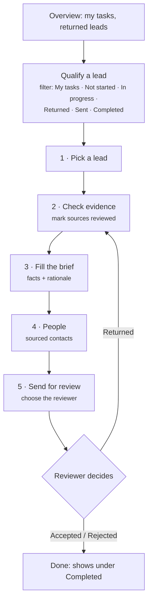

- **Find leads** (Discover): describe what you're looking for in plain words. Insyder shows how it understood the request **before** running it, then searches and lists matching companies.
- A research task from the admin opens straight in **Qualify a lead**. In **Work my tasks**, research tasks open there too.

### Sales reviewer

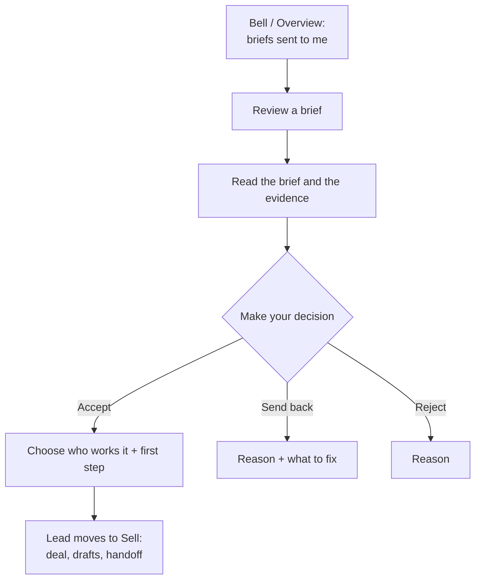

### SDR

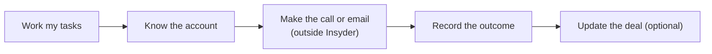

### Tenant admin

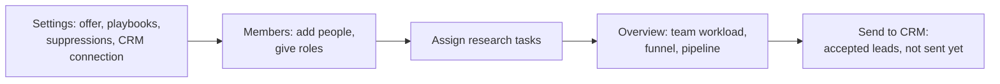

### Partner

Opens **Shared with me**, reads the fields shared with them, then **acknowledges** or **returns** each handoff.

---

## 6. How the parts connect

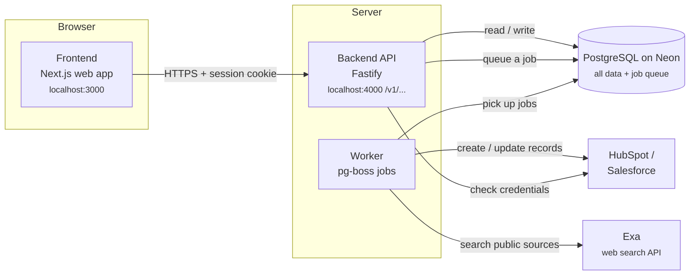

| Part | What it does |
|---|---|
| **Frontend** (`frontend/`) | Everything users see. Calls the API, keeps nothing secret. |
| **Backend API** (`backend/src/index.ts`) | Checks who you are and what your role allows, applies the business rules, reads and writes the database. Every address starts with `/v1/`. |
| **Worker** (`backend/src/worker.ts`) | Does the slow work in the background so pages never hang: research runs, CSV imports, CRM syncs, and scheduled monitor checks (every minute it queues monitors that are due). |
| **Database** | One PostgreSQL database holds all the data **and** the job queue. |
| **Exa** | The web search service research uses to find sources. See [How research works](exa-research.md). |
| **HubSpot / Salesforce** | The company's CRM. Accepted leads are sent there by the tenant admin. |

The API and the worker don't call each other. The API **writes a job** to the database, and the worker **picks it up**. If the worker is busy or restarting, jobs wait safely and run later.

---

## 7. What happens when you click something

### Example 1: "Run research" on an account

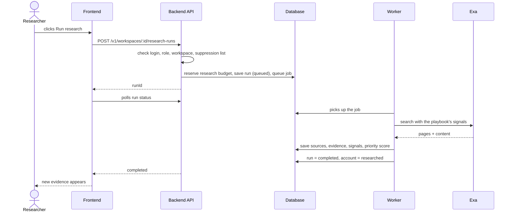

### Example 2: Sending a brief to a reviewer

```mermaid
sequenceDiagram
    actor R as Researcher
    participant API as Backend API
    participant DB as Database
    actor S as Sales reviewer

    R->>API: send for review (note + chosen reviewer)
    API->>API: reviewer must be a sales reviewer or admin;<br/>at least one reviewed source
    API->>DB: save rationale, status → Ready for review
    API->>DB: create a Sales review task for the reviewer
    API->>DB: complete the research task (if any)
    S->>API: opens the bell (refreshes every minute)
    API-->>S: "1 brief sent to you for review"
```

---

## 8. Folder map: what lives where

```
Insyder/
├── docs/                     ← you are here
├── backend/                  ← API + worker (Node.js, TypeScript)
│   └── src/
│       ├── index.ts          starts the API server
│       ├── worker.ts         starts the background worker
│       ├── auth/             passwords, sessions, role → permission list
│       ├── config/           reads and checks settings from .env
│       ├── middleware/       "who is calling and may they?" on every request
│       ├── routes/
│       │   ├── health.ts     /health check
│       │   └── v1/           one file per topic: the API addresses (107 endpoints)
│       ├── services/         the business rules, one file per topic
│       ├── jobs/             queues + handlers: research, CSV import, CRM sync, monitors
│       ├── providers/
│       │   ├── research/     Exa web search
│       │   └── crm/          HubSpot and Salesforce
│       ├── db/
│       │   ├── schema/       table definitions (one file per area)
│       │   ├── migrations/   numbered SQL changes to the database
│       │   ├── migrate.ts    applies migrations
│       │   └── seed.ts       creates the first company, workspace and admin
│       ├── utils/            small helpers: CSV, ids, encryption, normalising names
│       └── test/             release-gate and integration tests
└── frontend/                 ← web app (Next.js, React, TypeScript)
    └── src/
        ├── app/
        │   ├── login/        sign-in page
        │   ├── password/     forced password change
        │   ├── platform/     platform admin area
        │   └── [portal]/     every role's pages: /admin/..., /researcher/..., etc.
        │       ├── overview/   dashboards
        │       ├── discover/   find leads, playbooks
        │       ├── accounts/   watchlist, account page, qualify, review, CRM ...
        │       ├── outreach/   tasks, work my tasks, drafts
        │       ├── reports/    outcomes
        │       ├── members/    people and roles
        │       ├── settings/   offer, suppressions, usage, CRM, password
        │       └── shared/     partner handoffs
        ├── components/       reusable UI, grouped by area (accounts, overview, guide, ui ...)
        ├── hooks/            shared state: signed-in workspace, portal, guided steps
        └── lib/
            ├── api/          one file per topic: how the frontend calls the API
            ├── auth/         session calls and the role → permission list
            └── utils/        dates, CSV, small helpers
```

### Routes vs services (why two files with the same name)

Most topics have **two files with the same name**, for example `routes/v1/playbooks.ts` and `services/playbooks.ts`. They are **not duplicates**; they do two different jobs:

| File | Job | Example |
|---|---|---|
| `routes/v1/<topic>.ts` | The **front desk**: the web address, login and role check, input validation, audit log, the answer | "POST `/v1/workspaces/:id/playbooks`: is the caller an admin? is the body valid?" |
| `services/<topic>.ts` | The **actual rules** and database work, reused by several routes, the worker and tests | "create a new playbook version", "who can be a reviewer" |

The frontend mirrors this: `frontend/src/lib/api/<topic>.ts` holds the functions that call the matching routes.

### Why "v1"?

`/v1/` is the **version of the API**. If the API ever has to change in a way that would break existing callers (the frontend, a mobile app, a customer's integration), the new behaviour goes under `/v2/` while `/v1/` keeps working. Users never see it.

---

## 9. Ground rules the app enforces

- **Nothing is ever sent automatically.** No emails, calls or messages. Drafts are written, checked and approved, then people use them themselves.
- **Evidence first.** A lead can't be accepted without at least one reviewed source. Unknown facts stay "unknown" and never raise the score.
- **Sources are untrusted web data** until a person reviews them.
- **The priority score is a guide, not a promise.** It's 45% fit, 35% recency and 20% source quality. Missing dates cap recency.
- **The suppression list wins.** Companies or domains on it can't be researched or contacted.
- **Every decision is recorded** with who, when and why: acceptance decisions, playbook versions, superseded brief values and the audit log.
- **Each company's data is separate,** and each role only sees what it's allowed to. The server checks this on every request, not just the menu.
