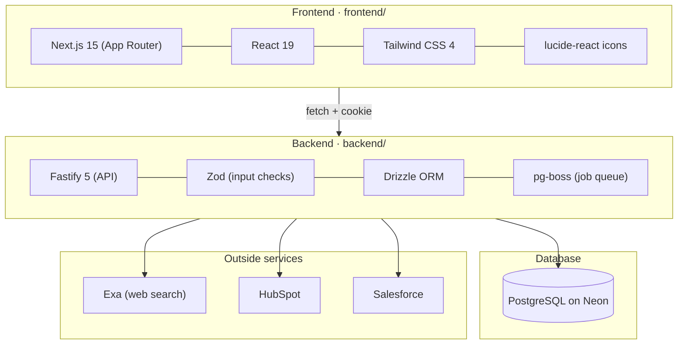
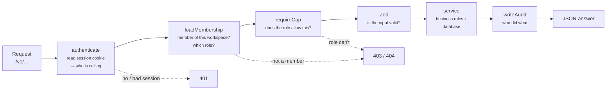
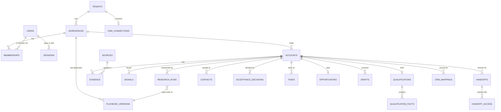
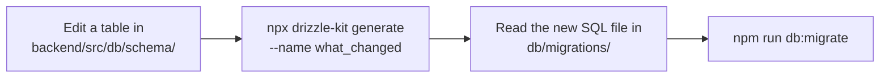

# Tech and data

- [1. The stack at a glance](#1-the-stack-at-a-glance)
- [2. Frontend](#2-frontend)
- [3. Backend](#3-backend)
- [4. Database](#4-database)
- [5. How data is stored](#5-how-data-is-stored)
- [6. Keeping things safe](#6-keeping-things-safe)
- [7. Background jobs](#7-background-jobs)
- [8. Outside services](#8-outside-services)
- [9. Settings (.env)](#9-settings-env)
- [10. Changing the database (migrations)](#10-changing-the-database-migrations)
- [11. Tests](#11-tests)

---

## 1. The stack at a glance



Everything is written in **TypeScript**, in both the frontend and the backend.

---

## 2. Frontend

| Tool | Version | Used for |
|---|---|---|
| **Next.js** | 15.5 | The web app framework: pages, routing (`src/app/...`), dev server (`npm run dev`, Turbopack) |
| **React** | 19.1 | Building the UI from components |
| **TypeScript** | 5 | Types, so mistakes are caught before running |
| **Tailwind CSS** | 4 | Styling with utility classes. Shared colours live as CSS variables in `src/app/globals.css` (`--red`, `--navy`, `--line` …) |
| **lucide-react** | 1.x | Icons |
| **ESLint** | 9 | Code checks (`npm run lint`) |

### How the frontend is organised

- **Portals by role:** every signed-in page lives under `src/app/[portal]/...`, and the first part of the address is the role's portal (`/admin/accounts/watchlist`, `/researcher/accounts/qualify` …). The menu for each portal is defined in `src/components/layout/portals.ts`.
- **Talking to the API:** `src/lib/api/client.ts` sends every request to `NEXT_PUBLIC_API_URL` (default `http://localhost:4000`) with `credentials: "include"`, so the browser sends the session cookie. One file per topic (`lib/api/accounts.ts`, `lib/api/tasks.ts` …) wraps the calls.
- **Who am I:** `src/hooks/useWorkspace.tsx` loads the signed-in user, their workspaces, the selected workspace and that role's **capabilities**. Pages check `can("…")` to show or hide actions. The server checks again on every request.
- **Remembered choices** (selected tab, guided step, dismissed hints) are kept per user in the browser's localStorage (`usePersistentState`).

---

## 3. Backend

| Tool | Version | Used for |
|---|---|---|
| **Node.js** + **TypeScript** | 5.8 | Runtime and language (ES modules) |
| **Fastify** | 5 | The HTTP API server |
| **@fastify/cookie**, **@fastify/cors** | 11 | Session cookie; allowing only the frontend's address to call the API |
| **Zod** | 3 | Checking every request body and query before it's used |
| **Drizzle ORM** | 0.43 | Typed database queries; table definitions in `src/db/schema/` |
| **drizzle-kit** | 0.31 | Generating migrations, `npm run db:studio` to browse data |
| **@neondatabase/serverless** | 1 | Fast database connection over HTTP for the API |
| **pg** | 8 | Direct database connection for migrations and the job worker |
| **pg-boss** | 10 | Job queue stored in PostgreSQL: research, imports, CRM sync, monitors |
| **bcryptjs** | 3 | Hashing passwords |
| **exa-js** | 1.10 | Exa client: search, find similar, answer, Websets |
| **nanoid** | 5 | Short unique ids with a readable prefix (`acc_…`, `pbk_…`, `ses_…`) |
| **tsx**, **concurrently** | — | Running the API and the worker together in development |
| **Vitest** | 3 | Tests |

### How a request is handled



Roles and what each may do are defined once in `backend/src/auth/permissions.ts`, as a list of **capabilities** per role, e.g. `research`, `qualify`, `accept`, `manage_integrations`. The frontend mirrors this list in `src/lib/auth/capabilities.ts`.

---

## 4. Database

- **PostgreSQL**, hosted on **Neon** (serverless Postgres with branches).
- Two connection strings:
  - `DATABASE_URL` (pooled): used by the API through Neon's HTTP driver.
  - `DATABASE_URL_UNPOOLED` (direct): used by migrations and the job worker, which need a long-lived connection.
- The **job queue** (pg-boss) lives in the same database, in its own `pgboss` schema.
- Applied migrations are tracked by Drizzle in the `drizzle.__drizzle_migrations` table.

---

## 5. How data is stored

There are **37 tables**, grouped by area. Each area has one file in `backend/src/db/schema/`.

| Area (schema file) | Tables | What's in them |
|---|---|---|
| **Identity** (`identity.ts`) | `tenants`, `workspaces`, `users`, `memberships`, `sessions` | Companies, workspaces, people, who has which role where, signed-in sessions |
| **Sign-up** (`accessRequests.ts`) | `access_requests` | "Create account" requests waiting for the platform admin |
| **Accounts** (`accounts.ts`) | `accounts`, `account_identities`, `merge_candidates`, `import_jobs` | The leads, their alternative names/domains, possible duplicates to merge, CSV import jobs and row reports |
| **Targeting** (`config.ts`) | `offers`, `playbook_versions` | What the company sells and to whom; playbooks (signals to look for), **one row per saved version** |
| **Research** (`research.ts`) | `research_runs`, `sources`, `evidence`, `signals`, `provider_usage` | Each research run, the web pages found, the evidence taken from them (with review status), the buying signals, and the usage billed by the search provider |
| **Qualification** (`qualification.ts`) | `qualifications`, `qualification_facts` | The brief: rationale plus facts, each with its basis (source / guess / confirmed) and sources; old values are kept as history |
| **People** (`contacts.ts`) | `contacts`, `role_hypotheses` | Real contacts (always with a source) and guessed roles (no person attached) |
| **Workflow** (`workflow.ts`) | `acceptance_decisions`, `tasks`, `activities`, `handoffs`, `handoff_access` | Every accept/return/reject with who and why, tasks and their outcomes, partner handoffs and who they're shared with |
| **Deals** (`opportunities.ts`) | `opportunities` | Deal stage, value and currency, separate from acceptance |
| **Outreach** (`drafts.ts`) | `drafts` | Message drafts and their approval |
| **CRM** (`crm.ts`) | `crm_connections`, `crm_mappings` | The company's CRM connection (encrypted credential) and which Insyder record became which CRM record |
| **Monitors** (`monitors.ts`) | `monitors`, `monitor_runs`, `change_events` | Saved watches, each scheduled check, and the changes they found |
| **Limits** (`ops.ts`) | `entitlements` | What a workspace may use (research on/off, CRM on/off, limits) |
| **Do-not-contact** (`suppressions.ts`) | `suppressions` | Companies, domains or emails that must never be researched or contacted |
| **Audit** (`audit.ts`) | `audit_events` | Who did what, when, to which record |
| **Bell** (`notifications.ts`) | `notification_reads` | When each person last read or cleared each notification group |

### How the main tables connect



### Patterns used everywhere

| Pattern | What it means |
|---|---|
| **Every row knows its company and workspace** | Most tables carry `tenant_id` and `workspace_id`, and every query filters by them, so one company can never read another's data. |
| **Readable ids** | Ids are text with a prefix: `acc_…` account, `pbk_…` playbook version, `rr_…` research run, `ses_…` session. You can tell what an id is from its prefix. |
| **History, not overwriting** | Playbooks add a new version on every save; brief facts keep superseded values; every acceptance decision is its own row; the audit log records every change. Nothing important is silently replaced. |
| **Optimistic locking** | Records people edit (accounts, briefs, deals) have a `version` number. Saving with an old version is refused ("changed by someone else"), so two people can't overwrite each other. |
| **Timestamps with time zone** | All dates are stored as `timestamp with time zone` (UTC). |
| **Lists stored as JSON text** | Small lists (e.g. a playbook's signals, a fact's evidence ids) are stored as JSON in `*_json` columns. |

---

## 6. Keeping things safe

| What | How it's stored or protected |
|---|---|
| **Passwords** | Hashed with **bcrypt** (cost 12). The password itself is never stored. |
| **Sessions** | On sign-in the server creates a random 32-byte token, valid **14 days**. The browser gets it in an **httpOnly** cookie (`insyder_session`; `Secure` and `SameSite=None` in production). The database stores only a **SHA-256 hash** of the token, so a database leak can't be used to sign in. |
| **CRM credentials** | Encrypted with **AES-256-GCM** before saving. The key comes from `SECRETS_ENCRYPTION_KEY` (or is derived from `AUTH_SECRET`). The API never sends a credential back, only a short hint. |
| **Who may call the API** | CORS allows only `FRONTEND_ORIGIN`. Every route checks the session, the workspace membership and the role's capability. |
| **Input** | Every request body and query is validated with Zod before use. |
| **Logs and errors** | Secrets are redacted (`utils/redact.ts`). |
| **Research budget** | Each company has a monthly research quota. A run reserves units first and is refused if the quota would be exceeded. |

---

## 7. Background jobs

The worker (`npm run worker`, or with the API via `npm run dev`) runs these queues from **pg-boss**:

| Queue | Started by | What it does |
|---|---|---|
| `research-run` | Run research, Find leads, Find similar, Build a list | Searches Exa using the playbook's signals, saves sources, evidence, signals and scores (see [How research works](exa-research.md)) |
| `csv-import` | Upload CSV | Reads the mapped rows, creates accounts, flags possible duplicates, writes a row report |
| `crm-sync` | Send to CRM | Creates or updates the company, contacts and deal in HubSpot or Salesforce, then records the result |
| `monitor-check` | Every minute, for monitors that are due | Re-checks watched accounts and records new changes |

Jobs are stored in the database, so they survive restarts. Research retries up to 3 times, imports and monitor checks up to 2. A CRM sync doesn't retry by itself: its result (Synced / Failed) is shown, and the admin sends again so nothing is duplicated in the CRM.

---

## 8. Outside services

| Service | Code | Used for |
|---|---|---|
| **Exa** | `backend/src/providers/research/exa.ts` | Search, site crawl, find similar, Why now? answers and Websets lists for research and monitors (`EXA_API_KEY`). Details in [How research works](exa-research.md) |
| **HubSpot** | `backend/src/providers/crm/hubspot.ts` | Creating companies, contacts and deals |
| **Salesforce** | `backend/src/providers/crm/salesforce.ts` | The same in Salesforce |
| **Neon** | `backend/src/db/client.ts` | Hosted PostgreSQL |

Each provider sits behind a small interface (`providers/*/types.ts`), so another search provider or CRM can be added without touching the rest of the code.

---

## 9. Settings (.env)

**Backend (`backend/.env`)**

| Name | Required | Meaning |
|---|---|---|
| `DATABASE_URL` | yes | Pooled Neon connection, used by the API |
| `DATABASE_URL_UNPOOLED` | yes | Direct connection, used by migrations and the worker |
| `AUTH_SECRET` | yes | 16+ characters; used to hash session tokens |
| `FRONTEND_ORIGIN` | yes | The web app's address, e.g. `http://localhost:3000` |
| `EXA_API_KEY` | for research | Exa search key |
| `SECRETS_ENCRYPTION_KEY` | recommended | Key for encrypting CRM credentials |
| `PORT` | no | API port (default 4000) |
| `NODE_ENV` | no | `production` turns on secure cookies |

**Frontend (`frontend/.env.local`)**

| Name | Meaning |
|---|---|
| `NEXT_PUBLIC_API_URL` | The API's address (default `http://localhost:4000`) |

Never commit `.env` files.

---

## 10. Changing the database (migrations)



- Migrations are numbered SQL files (`0000_…` to `0013_…`) and run in order. Each one runs only once per database.
- **Always read the generated SQL before running it.** For example, `drizzle-kit` once tried to re-create a table that already existed.
- Try migrations on a **Neon branch** before the main database.

---

## 11. Tests

```bash
cd backend
npm test                                                   # unit tests (Vitest)
TEST_DATABASE_URL=<throwaway database> npm run test:gates  # the release-gate tests
```

- Unit tests sit next to the code they test (`*.test.ts`).
- The gate tests check the Phase 1 rules end to end (data separation, roles, evidence before acceptance, suppression, budget …). They refuse to run against the `DATABASE_URL` in `.env`; use a throwaway Neon branch.
- Frontend checks: `npx tsc --noEmit` (types) and `npm run lint`.
